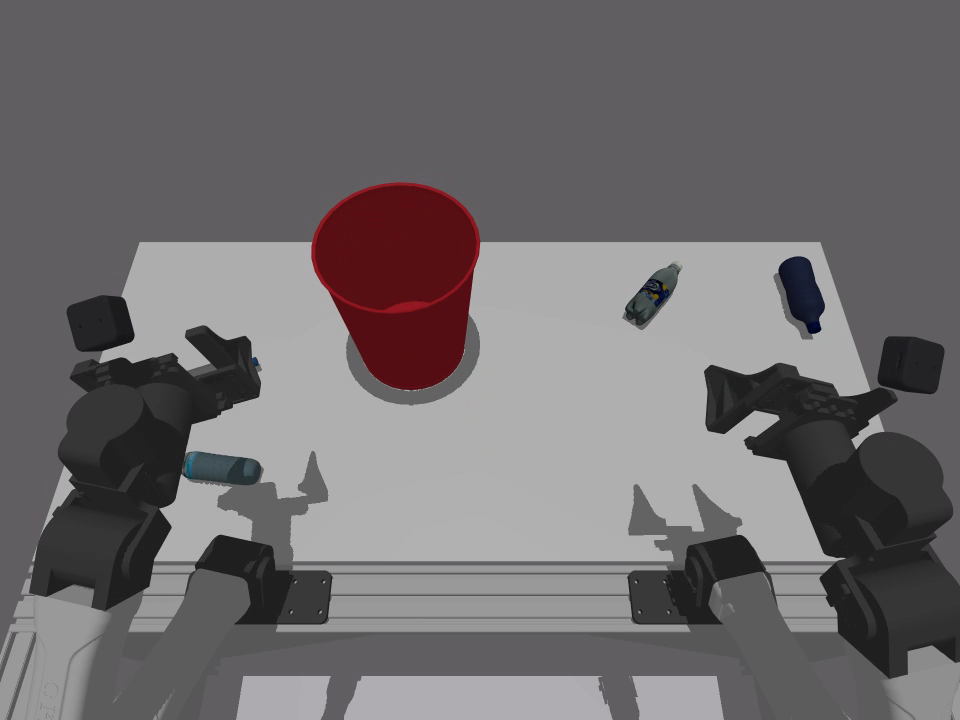
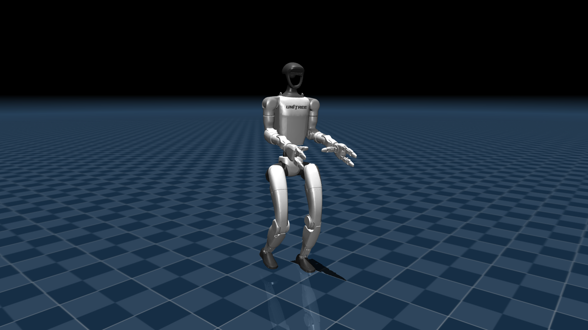
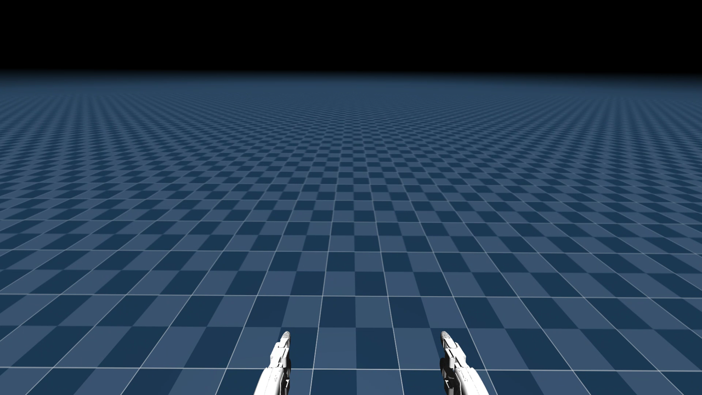

`adamo simulate` runs a robot in [MuJoCo](https://mujoco.org) on your computer and streams it to Adamo like a real one. Use it to try the operator page, VR teleop, recording and hosted inference before you have hardware.

## Run it

```sh
pip install "adamo[simulator]"
export ADAMO_API_KEY=ak_...   # Settings → API Keys
adamo simulate
```

It prints a link to the robot on [operate.adamohq.com](https://operate.adamohq.com). Each simulator has its own dependencies, which [uv](https://docs.astral.sh/uv/) installs into your user cache on the first run; the `simulator` extra brings uv along if you don't have it.

| Option | Effect |
|--------|--------|
| `--robot yam` | Two YAM arms on a table (the default) |
| `--robot g1` | A Unitree G1 humanoid that walks |
| `--name NAME` | The robot name to stream as |
| `--viewer` | Also open a MuJoCo window |
| `--record` | Record the robot while someone controls it (see [Recording](/recording/)) |
| `--help` | All options for the chosen robot |

## YAM arms

```sh
adamo simulate --robot yam
```



Two YAM arms put plastic bottles in a bin, a task from [ABC](https://abc.bot). The robot streams a stereo head camera (`head`) and a camera on each wrist (`wrist_left`, `wrist_right`).

- **VR:** hold a Quest controller's grip button to move that arm's gripper with your hand, and squeeze the trigger to close it.
- **Programs:** send 14 joint targets, `{"action": [left_j1..j6, left_grip, right_j1..j6, right_grip]}`, on any `control/` channel. Grippers go from `0` (closed) to `1` (open).
- **Hosted policy:** `adamo simulate --inference` has Adamo's hosted policy put the bottles in the bin. See [Inference](/inference/).

When every bottle is in the bin, the scene resets with new bottles.

## G1 humanoid

```sh
adamo simulate --robot g1
```



A Unitree G1 walks with NVIDIA's [GR00T whole-body controller](https://github.com/NVlabs/GR00T-WholeBodyControl). The first run downloads the robot model and the walking policies (about 34 MB). The arms hold still; the G1 only walks for now.

The head has two cameras 6 cm apart, streamed as the two eyes of a [stereo pair](/cameras/#stereo-cameras) (`head_left` and `head_right`, 1920×1080 each), so a headset shows depth.



Drive it from the operator page:

| Input | Walk | Turn | Step sideways |
|-------|------|------|---------------|
| Keyboard | W / S or ↑ / ↓ | A / D or ← / → | Q / E |
| Gamepad | Left stick | Right stick | Left stick |
| Quest controllers | Left thumbstick | Right thumbstick | Left thumbstick |

From a program, send a velocity in m/s and rad/s on `control/cmd_vel` at least every 0.5 s:

```json
{"linear": {"x": 0.4, "y": 0.0}, "angular": {"z": 0.5}}
```

The robot stops by itself when every input goes quiet, so a closed tab or a dropped connection never leaves it walking. If it falls, it stands back up a second later.
